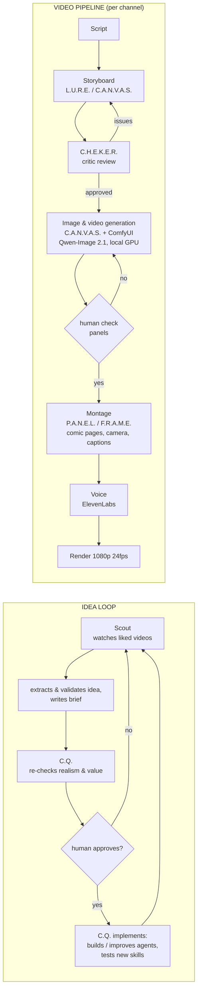

# Autonomous Agent Colony — AI Automation Portfolio

**AI Automation Engineer** — remote
I build autonomous multi-agent systems in Python that do real work — research, idea validation,
content production and video pipelines — with exactly one human checkpoint per loop.

> The colony is live: Telegram bots, local GPU generation, weekly video production. This repository
> shows how it is designed and how it works. No invented clients, no demo-only code.

---

## The core: one autonomous loop, two pipelines



**The idea loop.** Scout watches videos I liked, extracts the idea, checks how realistic it is for us
(or proposes a replacement), writes the brief to a file and hands it to C.Q. C.Q. re-validates it —
is it real, is it needed, what can be improved — then asks me for permission, listing pros, cons and
nuances, and only then starts building or improving agents.

**The video pipeline.** A script becomes a storyboard; the critic (C.H.E.K.E.R.) reviews it and sends
it back until it passes; then the image agent generates panels locally; **the single human checkpoint**
is me reviewing the panels; after approval the montage agent assembles the comic-page video with voice
and renders 1080p.

**Parallelism.** Each channel (channel1, Channel Two) has its own director + montage pair, so two
videos can be produced at the same time.

---

## Why this is engineering, not prompts

- Real systems, **running 24/7 in Telegram**, not screenshots of a chat.
- The human is in the loop exactly **once** per loop (approval), everything else is automatic.
- Image generation runs **locally** (ComfyUI, RTX 5060, 8 GB VRAM) — marginal cost of content ≈ $0.
- Agents coordinate through **files, handoffs and a queue with a review state machine** — not through
  memory of one long chat.

---

## The fleet

| Agent | Role | Status |
|---|---|---|
| **C.Q.** (coder) | creates and improves agents, validates new skills, hands-on work | live |
| **Scout** (curator) | walks the liked-videos playlists (YouTube/Instagram), breaks each video down, judges what is realistic to replicate and how to do it better, writes briefs | live |
| **C.A.N.V.A.S.** | storyboard + image **and video** generation (Qwen-Image 2.1, ComfyUI, local GPU) | live |
| **C.H.E.K.E.R.** (director) | storyboard critic — review loop until approved | live |
| **P.A.N.E.L.** | montage for the first channel: comic pages, camera moves, captions | live |
| **L.U.R.E.** (forge) | director / storyboard for Channel Two | live |
| **F.R.A.M.E.** (cut) | montage for Channel Two | live |
| **WatchButler** | personal butler: tasks, calendar, journal, job search, cross-agent memory | live |
| **RiceBot** | health coach: training, nutrition, sleep | live |
| **Sonar** (ytanalyst) | YouTube trends and scenario research | live |

Each agent is a **separate profile** with its own personality rules (SOUL), incoming handoff folder,
cron schedule and Telegram bot — see `bots/`.

## In progress

| Item | What it will do |
|---|---|
| **Skill Scout** | reads the shared Obsidian memory to learn what I am working on, then finds good and fresh GitHub repositories matching those needs — new skills for the colony |
| **Agent Office** | pixel-art office where every bot is a character: walks to its desk, types, drinks coffee; click opens its real chat/log. Built by the **C.Q.** coder agent via opencode. Planned centerpiece: an **orchestrator bot** — voice communication, task delegation to other agents in the moment, and computer control by voice. Plan: `bots/agent-office.md` |

**Shared memory:** all agents keep their long-term memory in one Obsidian vault (markdown files:
tasks, calendar, journal, handoff folders) — that is how the colony remembers and coordinates.

---

## Stack

Python · Hermes agent framework · OpenRouter (deepseek) · Ollama local (qwen2.5) ·
ComfyUI + Qwen-Image 2.1 (local) · ElevenLabs TTS · ffmpeg + HyperFrames/GSAP montage ·
SQLite · Telegram Bot API · Google Drive · Obsidian (shared agent memory) · cron

## Repo layout

```
bots/       — one doc per agent (role, tools, workflow)
pipeline/   — storyboard, page layout, image generation scripts
montage/    — video assembly engine + comic-page render mode
shots/      — screenshots for the case pages
.env.example — env template (real secrets are never committed)
```

## Case studies

**1. Autonomous video channel.** One script in a watched folder becomes a finished comic-style video
with voice — no human except one panel check. Real numbers from the pilot episode: 92 panels
generated in ~27 minutes on the local GPU, comic pages with camera moves and page turns, 1080p24 render,
halftone print look. Render samples: `shots/`.

**2. Idea loop.** Scout walks the liked-videos playlists and breaks each video down; C.Q. re-validates
the idea and asks the human for approval with pros/cons; only then implementation starts.

**3. Personal butler.** Tasks, calendar, journal, reminders, job-search tracking (applications,
interviews, platforms) and cross-agent memory search — one script searches every agent's chat history.

*More case pages and a screen recording are being prepared.*

## Security

Real keys (OpenRouter, ElevenLabs, Telegram tokens) are **never** in this repository — only
`.env.example` with placeholders. `.gitignore` excludes `.env`, databases and logs.

---

## Case studies

- **Autonomous video channel** — from script to finished comic-style video with voice, no human except
  one panel check (case study + render samples: see `shots/` and linked videos).
- **Agent colony management** — C.Q. building and improving agents, Scout feeding it validated ideas.
- **Personal butler** — tasks, reminders, calendar, job-search tracking, cross-agent memory search.

*Detailed case pages and screen recordings are being prepared.*
